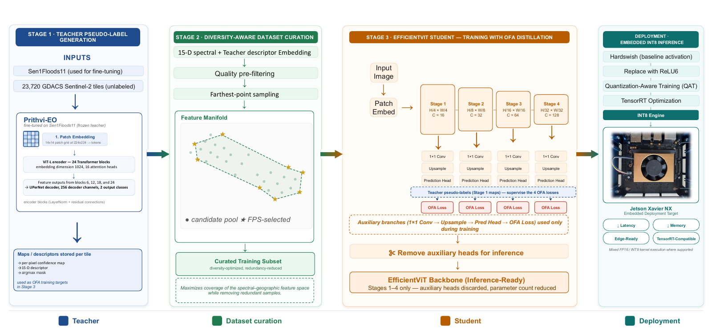

# FloodDistill

Code for *Cross-Architecture Foundation-Model Distillation for Edge Flood
Segmentation* (Schmalstieg, Müller, Samek).
[preprint]()

The frozen Prithvi-EO-2.0-300M Sen1Floods11 checkpoint supervises an
EfficientViT-B0 student on additional GDACS Sentinel-2 imagery. The paper compares
training sources at N=252, scales the pseudo-label pool to N=2,500, and evaluates
a ReLU6/QAT student on a Jetson Xavier NX. The teacher is not fine-tuned again here.

<p align="center">
  <a href="paper_source_data/Figure_01_Pipeline_Overview/pipeline.pdf">
    
  </a>
</p>

Training and evaluation code, experiment recipes, paper source data and figure
scripts are included here. The deployed INT8 student is in
`jetson_repro/runs/deploy_qat/docker_qat/`, as ONNX and as the TensorRT engine built on the
reference Jetson.

## Quick start

Run all commands from the repository root.

**Check the paper tables** (no GPU, no data):

```bash
docker build -f docker/Dockerfile -t flooddistill .
docker run --rm flooddistill python evaluation/verify_paper_source_data.py
```

**Train on Sen1Floods11 only** (GPU, ~1 GB data plus the 1.2 GB teacher): steps [1](#1-environment),
[2](#2-data) and [4](#4-training) with `LABELS=s11`. Of step 2, only `prepare_sen1floods11.sh`
is needed here; `fetch_all.sh` also pulls the evaluation sets, about 11 GB in all.

**Full reproduction** (GPU, Google Earth Engine account): steps 1–6 in order.

**Requirements.** Linux with an NVIDIA GPU (tested on an RTX 4090, 24 GB).
Disk: Sen1Floods11 1 GB, STURM-Flood 6 GB, WorldFloods-v2 test split 3 GB,
raw GDACS tiles 11 GB, pseudo-label pool 38 GB, teacher checkpoint 1.2 GB,
Docker image 36 GB.

## Paper and code

| Component | Files |
|---|---|
| Dataset loading and preprocessing | `data/sen1floods11.py`, `data/ood_datasets.py`, `data/unlabeled.py` |
| GDACS acquisition and pseudo-labels | `datasets/prepare.sh`, `scripts/train.py pseudo generate` |
| Pre-filter and FPS; selector controls | `scripts/curate.py`, `experiments/build_indices.sh`, `experiments/curation_compare.sh` |
| Teacher, students, CE / Logit-KD / OFA | `models/`, `training/`, `distillation/ofa_kd.py` |
| Matched budget and scaling | `experiments/nsweep_pseudo_vs_gt.sh`, `experiments/repro_n2500.sh` |
| Evaluation and paired statistics | `evaluation/`, `experiments/perscene_sweeps.sh` |
| Geometry, scale, spectral-index and robustness controls | `experiments/b1_crop_train.sh`, `experiments/perscene_controls.sh`, [control notes](docs/06_controls.md) |
| QAT, ONNX and Jetson | `scripts/quantize.py`, `quantization/`, `jetson_repro/` |
| CKA, gradient diagnostics and figures | `analysis/`, `figures/` |
| Submitted values and raw evaluation records | [paper_source_data/](paper_source_data/README.md) |

`scripts/` provides the main Python commands; `experiments/` holds the run recipes.
`datasets/` downloads data, while `data/` loads it. `docker/` provides the container.

## 1. Environment

**Docker** (recommended for review; needs the NVIDIA Container Toolkit):

```bash
docker build -f docker/Dockerfile -t flooddistill .
```

Data mounts and the training, evaluation and export services are described in
[docker/README.md](docker/README.md). Download the data first (step 2). That download
runs on the host and uses the conda environment below (gsutil, huggingface_hub), so set
it up even if you train in Docker.

**Conda.** `environment.yml` records the reference Linux environment.

```bash
conda env create -f environment.yml
conda activate esi
git clone https://github.com/mit-han-lab/efficientvit ../efficientvit
pip install -e ../efficientvit
pip install 'numpy==2.2.6'
export PYTHONPATH="$PWD:$(realpath ../efficientvit)${PYTHONPATH:+:$PYTHONPATH}"
bash datasets/download_efficientvit_ckpts.sh
```

NumPy is restored after the upstream install because its dependencies constrain
NumPy differently. `requirements-teacher.txt` includes the base dependencies;
`requirements.txt` alone is insufficient for the training/data imports.

## 2. Data

All models use B2, B3, B4, **B8A**, B11 and B12. Sen1Floods11 supplies the official
training/validation/test splits; GDACS supplies additional training images.
STURM-Flood and WorldFloods-v2 are external evaluation sets.

All datasets live under one directory, `DATA_ROOT` (default `~/data`). Every script
and recipe derives its paths from it ([data paths](docs/DATA_LOCATION.md)):

```text
$DATA_ROOT/
├── sen1floods11/v1.1/
├── STURM-Flood/Dataset/
├── WorldFloodsv2/test/
└── flood_unlabeled/         # raw GDACS tiles, step 3
```

```bash
export DATA_ROOT=/path/to/data
bash datasets/fetch_all.sh
```

`fetch_all.sh` downloads Sen1Floods11, STURM-Flood, the WorldFloods-v2 test split, the
EfficientViT weights and the teacher checkpoint (into `HF_HOME` if set). Each dataset can also
be downloaded on its own:

```bash
bash datasets/prepare_sen1floods11.sh "$DATA_ROOT/sen1floods11"        # Sen1Floods11, needs gsutil
wget -O sturm.zip "https://zenodo.org/records/12748983/files/Dataset.zip?download=1" \
  && unzip sturm.zip -d "$DATA_ROOT/STURM-Flood"                          # STURM-Flood
hf download isp-uv-es/WorldFloodsv2 --repo-type dataset \
  --include "test/*" --local-dir "$DATA_ROOT/WorldFloodsv2"               # WorldFloods-v2 test
```

WorldFloods-v2 already contains the Sentinel-2 images, labels and JRC permanent-water
masks (`test/{S2,gt,PERMANENTWATERJRC}`). See [datasets/README.md](datasets/README.md).


## 3. Pseudo-labels

After Earth Engine authentication, download, pseudo-label and select N=2,500 GDACS tiles:

```bash
EE_PROJECT=YOUR_PROJECT_ID bash datasets/prepare.sh
```

To generate labels from an existing raw pool:

```bash
python scripts/train.py pseudo generate --official_ckpt hf \
  --unlabeled_root "$DATA_ROOT/flood_unlabeled" --unlabeled_source flood \
  --out_dir data/pseudo_gdacs --confidence_threshold 0.80 \
  --min_flood_frac 0.0 --store_pixel_confidence
python scripts/curate.py diversity --pseudo_dir data/pseudo_gdacs --top_k 252
python scripts/curate.py diversity --pseudo_dir data/pseudo_gdacs --top_k 2500
```

Pseudo images, hard masks and confidence maps are stored at 224×224. The reported
Logit-KD/OFA runs obtain soft targets from the live frozen teacher. FPS uses the
15-D descriptor after the `f ∈ [0.05,0.85]`, `conf_std ≥ 0.05` pre-filter.
The loader samples uniformly from the index. Each index therefore needs exactly
its training N.

[data/index_files_curations/](data/index_files_curations/README.md) ships the indices
behind the paper's own runs (N=20 up to 4,000, plus the selector-comparison indices), built
on our pool. If a training recipe asks for an index that PSEUDO_DIR does not have, it also
checks `data/` and `data/index_files_curations/` before giving up.

## 4. Training

The shell recipes set the paper's seeds (42, 64, 91, 107), losses, augmentation,
learning rate and determinism flags. `dfkd` in run names means Logit-KD.

```bash
# Five architecture/objective cells for each label source, Table I:
LABELS=s11 N_VALUES=252 bash experiments/nsweep_pseudo_vs_gt.sh
LABELS=pseudo N_VALUES=252 bash experiments/nsweep_pseudo_vs_gt.sh
# Table II budget; needs diversity_N2500_index.json:
LABELS=pseudo N_VALUES=2500 bash experiments/nsweep_pseudo_vs_gt.sh
# EfficientViT OFA with Hardswish and ReLU6 (GPU IDs 0 and 1):
bash experiments/repro_n2500.sh
```

Set `PSEUDO_DIR`, `GPU`, `SEEDS`, `ARMS` and `EPOCHS` as supported by each recipe. There is
no UNet-OFA paper cell. Larger N sweeps need a separate index per N. Existing
`best.pt` files cause these recipes to skip runs. See [experiments/README.md](experiments/README.md).

## 5. Evaluation and controls

```bash
# N=2,500: the Table II arms, then the deployed ReLU6 student
python evaluation/eval_ablations.py --runs_base runs/nsweep \
  --runs_reg pseudo_ --n_filter 2500 --sturm_normalize original --gpu 0
python evaluation/eval_ablations.py --runs_base runs/repro \
  --runs_reg repro_ofa_relu6_N --n_filter 2500 --arch efficientvit_b0_relu6 \
  --sturm_normalize original --gpu 0
# N-sweep, both label sources. Shown for N=252; repeat for 50, 100, 150 and 200.
python evaluation/eval_ablations.py --runs_base runs/nsweep \
  --runs_reg pseudo_ --n_filter 252 --sturm_normalize original --gpu 0
python evaluation/eval_ablations.py --runs_base runs/ablations_sen1 \
  --runs_reg sen_ --n_filter 252 --sturm_normalize original --gpu 0
python evaluation/nsweep_collect.py
bash experiments/perscene_sweeps.sh
python evaluation/paired_group_tests.py
```

Use STURM's documented inverse `0.04 + 0.12*v`, then the S11 normalization.
The paper maps STURM classes 1/2 to water and 3/4/5 to ignore; WorldFloods
ignores clouds and JRC permanent water. Benchmark inputs are 512×512.
Micro pools pixel counts; macro averages the defined scene groups. Worst-case
drop is taken per seed before averaging. Do not merge caches from different
class mappings or evaluation scales.

Geometry-matched training, 128/224/512 STURM evaluation, scalar gain, haze,
per-band gain and MNDWI labeller controls are covered in
[docs/06_controls.md](docs/06_controls.md). The supplement's matched-budget robustness
test (S3) has one recipe, `bash experiments/robustness_b2.sh`, or the
`robustness-b2` Docker service ([docker/README.md](docker/README.md)).

## 6. QAT and deployment

After ReLU6 training, calibrate and run QAT on the same selected pool:

```bash
python scripts/quantize.py qat \
  --model_ckpt runs/repro/repro_ofa_relu6_N2500_s42/best.pt \
  --student_arch efficientvit_b0_relu6 --data_root "$DATA_ROOT/sen1floods11" \
  --pseudo_dir data/pseudo_gdacs --pseudo_dataset diversity --n_samples 2500 \
  --seed 42 --qat_epochs 10 --trt_compat jp50 --out_dir runs/quant/qat_s42
```

Use `model_qdq_trt_no_out.onnx` for the device build. Calibration uses S11
validation data; QAT updates the pseudo-trained student. QAT-stripped
`model_float*.onnx` files are export intermediates, not the pre-QAT float baseline.
See [quantization notes](docs/03_quantization.md) and [Jetson commands](jetson_repro/README.md).

## 7. Paper tables and figures

The table check needs no training:

```bash
python evaluation/verify_paper_source_data.py
```

It recomputes table cells from the supplied raw records. The source-file map is in
[paper_source_data/README.md](paper_source_data/README.md).

No trained runs or evaluation results are shipped under `runs/`. `bash figures/make_figures.sh`
draws Figs. 2, 4, 5 and S1, S3–S5 only after all experiments and evaluations have finished;
[figures/README.md](figures/README.md) lists what they read.

## License

The source code in this repository is released under Apache-2.0 ([LICENSE](LICENSE)). So are
the ONNX and TensorRT files of our trained student in `jetson_repro/runs/deploy_qat/docker_qat/`.

That license does not reach further than our own work. It does not cover:

- the datasets and the external pretrained weights, which are not distributed here (More detail, including library
licenses, is in [THIRD_PARTY_NOTICES.md](THIRD_PARTY_NOTICES.md).);
- figures you render yourself from these datasets (for example with `jetson_repro/deploy.sh`),
  which follow the datasets' terms; WorldFloods-v2 is non-commercial;
- third-party libraries, imported at run time under their own licenses.

Two parts of the code are adapted from EfficientViT (Apache-2.0); they are listed in
[THIRD_PARTY_NOTICES.md](THIRD_PARTY_NOTICES.md).

## Citation

The preprint is not online yet. Please cite it as below; the arXiv ID follows once it exists.

```bibtex
@misc{schmalstieg2026flooddistill,
  title         = {Cross-Architecture Foundation-Model Distillation for Edge Flood Segmentation},
  author        = {Schmalstieg, Fabian and M{\"u}ller, Karsten and Samek, Wojciech},
  year          = {2026},
  eprint        = {XXXX.XXXXX},
  archivePrefix = {arXiv}
}
```
